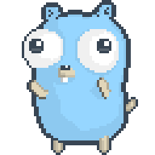
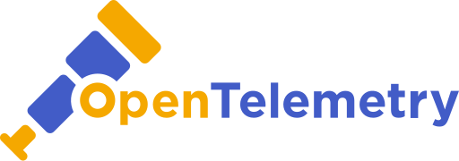
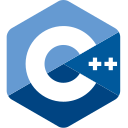

  

<h1 align="center">Hi, I'm Nikolay 👋</h1>

<strong>Backend Engineer (Go)</strong>

  
  
  
  

 

<h3 align="center">👨‍💻 About Me</h3>

Backend engineer working in Go. I build APIs and services with PostgreSQL, Kafka and gRPC, and I like making them fast and observable.  
Before Go I worked in C++ and Qt, building VoIP software and automotive HMI systems. That background still shapes how I think about concurrency, memory and latency.

 

<h3 align="center">🛠 Tech Stack</h3>

  
  
  
  
  
  
  
  
  

<em>Previously worked with</em>

  
  
  

<h3 align="center">🔥 My GitHub Stats</h3>

    

